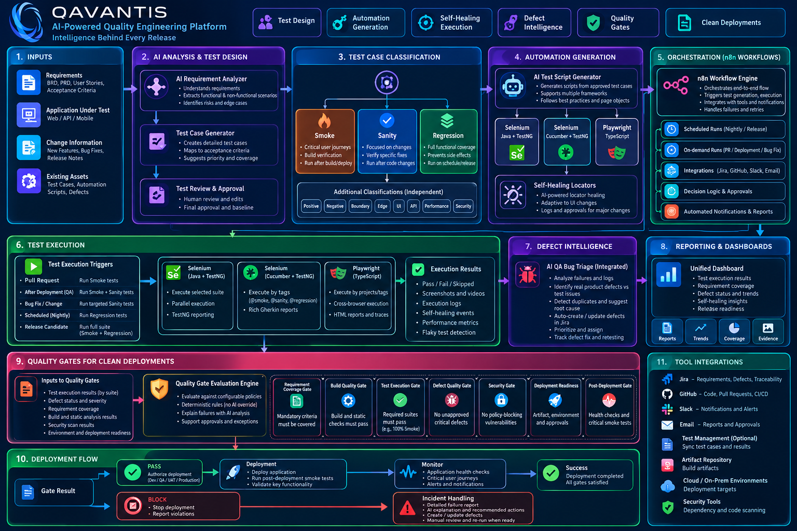

<div align="center">

# QAVANTIS
### AI-Powered Quality Engineering Platform

**Intelligence Behind Every Release.**

[](#project-status)
[](#overview)

</div>

---

## Architecture

Place the full-flow architecture image at `docs/images/qavantis-architecture.png` for it to display below on GitHub.



## Overview

QAVANTIS is a planned AI-powered quality engineering platform connecting sprint planning, requirements, test design, automation, execution intelligence, defect management, and release decisions in one traceable workflow.

AI can recommend and explain, but must not silently override required approvals or deterministic quality-gate rules.

## Core capabilities

- Sprint Test Planner with file uploads and Jira integration.
- AI-assisted requirement analysis and test-case generation.
- Test-case review, traceability, coverage and duplicate analysis.
- Automation suitability recommendations.
- Three framework-specific automation generation and execution workflows.
- Controlled self-healing locator support with evidence.
- Defect triage, duplicate detection, retesting and closure tracking.
- Deterministic quality gates for clean deployments.
- Interactive dashboards, reports and release-readiness metrics.

## Sprint Test Planner

The Sprint Test Planner supports two planned input methods and two planned output formats.

### Inputs

- **File uploads:** Excel, CSV, and sprint/story documents.
- **Jira integration:** sprint backlog, user stories, bugs, acceptance criteria, and available story metadata.

### Planning capabilities

- Summarize sprint scope and identify in-scope/out-of-scope work.
- Map stories and acceptance criteria to proposed test cases.
- Identify dependencies, risk areas, coverage gaps, and assumptions.
- Recommend test effort and capacity allocation using available estimates and team capacity.
- Plan Smoke, Sanity, and Regression coverage.
- Recommend `AUTOMATE`, `KEEP_MANUAL`, or `REVIEW`, with rationale.
- Draft test environments, test-data needs, entry/exit criteria, and unresolved risks.
- Support QA lead review and approval before finalization.

### Outputs

1. **Sprint test plan document** — scope, strategy, coverage, risks, dependencies, estimates, environments, entry/exit criteria, and approvals.
2. **Interactive sprint dashboard** — sprint scope, story/test traceability, coverage gaps, planned versus executed tests, status summaries, risks, and release readiness.

AI-generated recommendations and estimates are advisory. The QA lead approves the final scope, effort, and exit criteria.

## End-to-end workflow

1. **Ingest inputs** — requirements, user stories, acceptance criteria, sprint details, application changes, and existing test assets.
2. **Plan the sprint** — analyze backlog scope, risks, dependencies, capacity, and testing approach.
3. **Analyze requirements** — identify business rules, risks, and acceptance-criteria coverage.
4. **Design test cases** — generate steps, data, expected results, priorities, and requirement links.
5. **Review and classify** — assess coverage and duplicates; require human approval where appropriate.
6. **Recommend automation** — recommend `AUTOMATE`, `KEEP_MANUAL`, or `REVIEW`, with rationale.
7. **Generate and run tests** — execute through framework-specific generators and runners.
8. **Collect evidence** — results, screenshots, traces, logs, and environment metadata.
9. **Triage failures** — distinguish likely application defects from automation, test-data, and environment issues.
10. **Manage defects and retests** — prepare defect records, identify possible duplicates, track fixes, and verify retests.
11. **Evaluate release gates** — apply explicit policies before allowing or blocking deployment.
12. **Report quality** — coverage, execution results, defect trends, healing events, sprint progress, and release readiness.

## Automation frameworks

| Workflow | Planned stack | Intended use |
|---|---|---|
| Selenium + TestNG | Java, Selenium WebDriver, TestNG, Page Object Model | UI automation with Java |
| Selenium + Cucumber | Java, Selenium, Cucumber/Gherkin, TestNG, Page Object Model | BDD-style UI automation |
| Playwright | TypeScript, Playwright Test, Page Object Model | Modern browser automation |

These are separate generator and execution workflows with shared contracts for test cases, run results, evidence, and defects.

## Test classification

### Suite membership

A test can belong to more than one suite; suite membership is **not** mutually exclusive.

- **Smoke** — critical checks for basic build or deployment health.
- **Sanity** — targeted checks around a change or bug fix.
- **Regression** — broader checks for existing behavior.

### Independent test-type labels

Examples: `POSITIVE`, `NEGATIVE`, `BOUNDARY`, `EDGE`, `UI`, `API`, `PERFORMANCE`, and `SECURITY`. These describe the nature of a test and are independent of suite membership.

## Automation suitability

The planned engine will consider repeatability, regression value, frequency, stability, business risk, implementation effort, and maintenance cost. It will provide a recommendation and rationale rather than automatically treating every test as a candidate for automation.

## Self-healing safeguards

- Capture diagnostics when a locator fails.
- Distinguish locator failures from assertion failures.
- Evaluate candidate locators for uniqueness and intended-element match.
- Retry only under controlled conditions.
- Re-verify the original business assertion after recovery.
- Record changes and evidence; send ambiguous cases for human review.

A changed assertion outcome must never be treated as a successful locator repair.

## Defect intelligence

QAVANTIS is planned to integrate with the existing [AI QA Bug Triage n8n project](https://github.com/ankit19apr/ai-qa-bug-triage-n8n), extending it rather than rebuilding it.

Planned capabilities:
- Normalize failure payloads from each automation framework.
- Classify likely application, automation, test-data, or environment failures.
- Prepare structured defect reports with reproduction steps and evidence references.
- Identify potential duplicates and suggest severity/priority.
- Produce Jira-ready payloads with human approval.
- Track retests and defect closure according to explicit policy.

## Quality gates for clean deployments

Release decisions should use explicit, auditable policies. Planned checks include:

- Build, compile, lint, and type-check results.
- Required smoke-suite results and configured coverage thresholds.
- Defect severity limits and documented exceptions.
- Security and dependency checks where configured.
- Artifact, environment, configuration, and approval checks.
- Post-deployment health and smoke verification.

**PASS** authorizes the next configured release step. **BLOCK** stops the pipeline and reports failed policy checks. Exceptions must be authorized and audited. AI recommendations cannot override a deterministic gate.

## Planned architecture

```text
Sprint Backlog / Requirements / Changes / Test Assets
                         |
                         v
              Sprint Test Planner
           (File Uploads + Jira Integration)
                         |
             +-----------+-----------+
             |                       |
             v                       v
       Test Plan Document      Interactive Dashboard
             |                       |
             +-----------+-----------+
                         |
                         v
         Requirement Analysis & Test Design
                         |
                         v
         Review, Traceability & Classification
                         |
                         v
             Automation Suitability
                         |
              +----------+----------+
              |          |          |
              v          v          v
         Selenium    Selenium   Playwright
         + TestNG    + Cucumber + TypeScript
              |          |          |
              +----------+----------+
                         |
                         v
          Execution Orchestration & Evidence
                         |
                         v
           Failure Classification / Triage
                         |
                         v
                Retest & Defect Lifecycle
                         |
                         v
             Deterministic Quality Gates
                         |
                  +------+------+
                  |             |
                  v             v
             Allow release  Block release
                         |
                         v
            Metrics, Reports & Notifications
```

## Planned technology choices

The implementation will be incremental and local-first/cost-conscious, starting with mocked AI behavior before optional model-provider integration.

- **Automation:** Java, Selenium WebDriver, TestNG, Cucumber, TypeScript, Playwright Test
- **Orchestration:** n8n; test runners execute as separate processes
- **Persistence:** PostgreSQL as the planned source of truth
- **CI/CD:** GitHub Actions
- **Inputs and integrations:** Jira, Excel/CSV/document uploads, GitHub, Slack/email, test management, artifact storage, optional security tooling
- **AI:** provider-independent interfaces with local/mock implementations for early development

Never commit secrets, embed them in prompts, or write them to logs.

## Planned repository structure

```text
qavantis/
├── .github/workflows/
│   ├── java-testng.yml
│   ├── selenium-cucumber.yml
│   ├── playwright.yml
│   ├── n8n-validation.yml
│   └── quality-gate.yml
├── docs/
│   ├── images/qavantis-architecture.png
│   ├── architecture.md
│   ├── implementation-roadmap.md
│   └── data-model.md
├── sprint-planner/
│   ├── imports/
│   ├── planning/
│   └── reporting/
├── workflows/n8n/
├── database/migrations/
├── generators/
│   ├── selenium-testng/
│   ├── selenium-cucumber/
│   └── playwright-typescript/
├── defect-management/
├── tests/
├── .gitignore
├── CONTRIBUTING.md
└── README.md
```

This is the intended structure, not a claim that these components or workflows have already been implemented.

## Delivery roadmap

1. Repository conventions, architecture docs, and shared schemas.
2. Sprint Planner intake, plan generation, and human review.
3. Requirement-to-test-case design and traceability.
4. Persistence and manual execution tracking.
5. Automation-suitability recommendations.
6. Selenium + Java + TestNG generator and runner.
7. Selenium + Cucumber + TestNG generator and runner.
8. Playwright + TypeScript generator and runner.
9. Evidence capture and controlled self-healing.
10. Integrate existing n8n defect triage and add retest tracking.
11. Deterministic quality gates and GitHub Actions.
12. Interactive dashboards, sprint reports, and operational safeguards.

## Project status

**Planning / architecture stage.** QAVANTIS and the Sprint Test Planner are planned; implementation, GitHub Actions workflows, integrations, and deployment gates should be marked complete only after they have been built and verified.

## Contributing

Contribution guidance, coding standards, test commands, and pull-request checks will be added as implementation progresses.

## License

License not yet selected. Choose a license before distributing the project or accepting external contributions.
